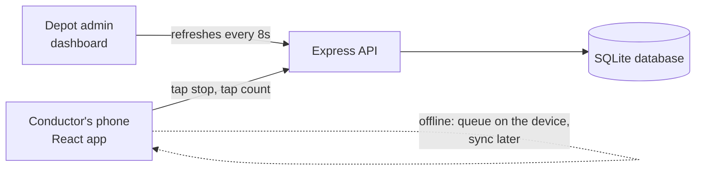

# Conductor Companion

**A bus ticketing app you can run with one thumb, in a swaying bus, in full sunlight.**

🔗 🔗 **Live demo:** [https://conductor-companion.onrender.com/](https://YOUR-LINK.onrender.com) (the first load can take a minute to wake up)

---

## Why this exists

Picture a bus conductor in a packed city bus. One hand holds a fistful of cash. The other holds the ticket machine, a heavy thermal-printer box with worn-out buttons and a screen you can't read in the sun. The bus lurches. Three people want tickets to three different stops.

This project asks a simple question: what if that machine were a phone app designed around those exact constraints, instead of a normal app squeezed into a bus?

It started as a design brief (digitise the conductor's machine, one-handed, under 4 seconds for a 3-passenger ticket, readable in glare). I turned it into a working product so the ideas can be tested by actually using them, not just looked at.

## Try it in 60 seconds

1. Open the live demo on your phone, or on a computer (it appears as a phone-sized screen).
2. Tap **New conductor? Create an account** and sign up with any email.
3. Tap a **stop** (the nearest stops are in the bottom row, closest to your thumb).
4. Tap **how many passengers**. That's it, the ticket is issued. Two taps.
5. Made a mistake? Tap **Undo** on the green strip within 5 seconds, or swipe it left.
6. Open the ⚙ menu to try the **night theme** or **left-hand mode**.
7. Want to see the other side? Open a private window and sign in as the depot admin to watch your tickets appear on the **dashboard** in real time.

<details>
<summary><b>Want to break it? Try these</b></summary>

- Turn on airplane mode (or DevTools → Network → Offline) and issue a few tickets. They queue on the device and sync when you're back online.
- Tap two things really fast. A double-tap guard ignores the accidental bounce a jolt would cause.
- Switch the fare type to Half or Free and watch the amount change.
- Sign in as admin on one window and a conductor on another, then issue tickets and watch the dashboard update.
</details>

## The design thinking, in plain words

| Problem on a real bus          | What the app does about it                                                                                                                                       |
| ------------------------------ | ---------------------------------------------------------------------------------------------------------------------------------------------------------------- |
| Only one hand is free          | Everything you tap lives in the lower part of the screen, inside the thumb's natural arc. The top is for reading only.                                           |
| The bus jerks                  | Big targets (about 76px for passenger counts) with real gaps between them. Taps register when you lift your finger, so sliding off cancels instead of misfiring. |
| Sunlight washes out the screen | Heavy type, strong contrast, and a dark-on-white **Sun** theme. A yellow-on-navy **Night** theme for evenings.                                                   |
| Every second counts            | Pick a stop, pick a count, done. No confirm screen. Mistakes are fixed by Undo, which is faster than asking "are you sure?" on every ticket.                     |
| Left-handed conductors exist   | One switch mirrors the layout so the most-used buttons start at the thumb.                                                                                       |
| Signal drops constantly        | Tickets issue offline, queue on the phone, and sync later without creating duplicates.                                                                           |

The thing I kept coming back to: **only four facts matter mid-ride.** Where are we, what's next, how much cash have I taken, did my last ticket go through. Those get the top of the screen and a status strip that never changes height, so nothing shifts under your thumb.

## How it works



- **Frontend:** React, built with Vite. One screen for conductors, one dashboard for admins.
- **Backend:** Node and Express, serving both the API and the built React app.
- **Database:** SQLite through Node's built-in `node:sqlite`, so there's nothing to install or configure.
- **Two roles:** conductors issue tickets, the admin sees everyone's totals.

<details>
<summary><b>Security, briefly</b></summary>

- Passwords are hashed with bcrypt, never stored as text.
- Login uses an HttpOnly cookie that scripts in the page can't read, marked secure in production.
- Login and sign-up are rate limited.
- The **server calculates every fare**. The phone only says which stop and how many people, so nobody can edit a price in the browser.
- Every ticket carries a unique id, so a retry after a bad connection can never create a double ticket.
- Inputs are validated on the server, and admin routes check the role.
</details>

<details>
<summary><b>API at a glance</b></summary>

| Method | Route                   | What it does                                        |
| ------ | ----------------------- | --------------------------------------------------- |
| POST   | `/api/auth/register`    | Create a conductor account                          |
| POST   | `/api/auth/login`       | Sign in                                             |
| POST   | `/api/auth/logout`      | Sign out                                            |
| GET    | `/api/auth/me`          | Who am I                                            |
| GET    | `/api/route`            | Stops and fare chart                                |
| POST   | `/api/tickets`          | Issue a ticket (safe to retry)                      |
| GET    | `/api/tickets`          | Today's tickets and totals                          |
| POST   | `/api/tickets/:id/void` | Undo a ticket (within 60 seconds)                   |
| GET    | `/api/admin/summary`    | Admin only: per-conductor totals and latest tickets |

</details>

## Run it on your own machine

You need **Node 22.13 or newer**.

```bash
npm install
npm run build
npm start
```

Then open http://localhost:3000.

For live reloading while editing, run `npm run server` in one terminal and `npm run dev` in another, then open http://localhost:5173.

**Accounts.** Conductors sign up inside the app. The admin account is created on first start from the `ADMIN_EMAIL` and `ADMIN_PASSWORD` environment variables. Please set your own password for anything public.

| Variable                        | What it's for                                               |
| ------------------------------- | ----------------------------------------------------------- |
| `JWT_SECRET`                    | Signs login cookies. Required in production.                |
| `ADMIN_EMAIL`, `ADMIN_PASSWORD` | The seeded admin account                                    |
| `DB_PATH`                       | Where the SQLite file lives (point it at a persistent disk) |
| `PORT`                          | Server port, default 3000                                   |
| `TZ`                            | Defines "today" for the totals, default Asia/Kolkata        |

## Deploying

The repo includes a `render.yaml`, so on Render you can choose **New → Blueprint**, pick this repo, set `ADMIN_PASSWORD`, and deploy.

## Honest limits

I'd rather tell you than have you find out:

- The route, stops and fares are **illustrative**. A real depot would load its own fare chart.
- Stops are advanced by a button. Real GPS stop detection isn't built.
- The offline queue works while the page is open. A full offline-first install (service worker) isn't built.
- There's no Bluetooth printer support yet, and no password reset.
- On a free host the SQLite file resets when the server restarts. Fine for a demo, not for real data.

## Where I'd take it next

- GPS-driven stops and automatic end-of-route flipping
- Sign in with Google or a phone number and OTP
- A service worker so the app opens fully offline
- Printer support, and a QR ticket if the printer fails
- Timing real conductors on real buses against the 4-second goal
